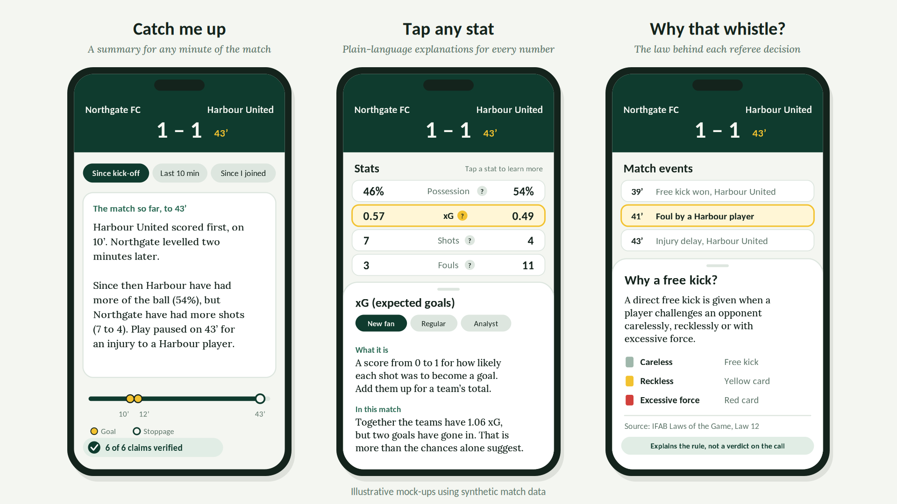
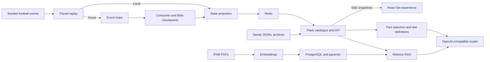

# Matchday Explainer

**Join late. Understand the match. Know the law behind the whistle.**

A football companion for fans who want context, not another wall of numbers.
Catch up on the moments you missed, explore statistics at your own reading
level, and inspect the IFAB passages behind a referee-law explanation.


*Design reference using illustrative synthetic data; not a live screenshot.*

## What makes it different

| Fan question | What the app does | Trust boundary |
| --- | --- | --- |
| “What did I miss?” | Kick-off, last-ten-minute and since-joining catch-ups; scrub to an earlier minute | AI selects recorded fact IDs. The server renders their text and numbers from match data. |
| “What does xG mean here?” | New fan, Regular and Analyst explanations for nine statistics | Definitions are AI-adapted; the displayed match values come from state, not the model. |
| “Why that whistle?” | Explains the applicable law, links retrieved passages and opens the original IFAB PDF | Only retrieved passages support rule answers. Missing event details are stated; the app does not judge the referee. |

**Built for a live demo:** adjustable pacing, unique replay IDs, shareable match
links, search/filter controls, local service checks and labelled fallbacks.
Matches are synthetic simulations, not an external live sports-data feed.

## Quick start

Requires **Python 3.11+**, **Node 24** and Redis. PostgreSQL/pgvector and an
OpenAI-compatible account enable IFAB RAG. Azure is optional.

### 1. Prepare services and backend

From the repository root:

```sh
# Optional: use these containers instead of existing local Redis/PostgreSQL.
docker compose up -d

cd backend
python3 -m venv venv
source venv/bin/activate
python -m pip install -r requirements.txt
cp -n .env.example .env
```

The copy command keeps an existing `.env`; compare it with `.env.example`
instead of overwriting your credentials. Compose uses local-only demo credentials and
ports 6379/5432. Do not start it on top of services already using those ports.

Set `OPENAI_API_KEY` in `.env` for AI. For RAG, set `DB_URI`, then:

```sh
python manage.py init-db
python app.py
```

In another terminal, index the bundled IFAB PDFs (embedding API calls may incur
cost; unchanged sources are skipped on subsequent runs):

```sh
curl -X POST http://localhost:8080/api/v1/rag/index
```

You can omit PostgreSQL, schema creation, indexing and the AI key to explore
saved matches and source-data summary/stat fallbacks. Leave `DB_URI` unset in
that mode. Referee RAG does **not** silently substitute an uncited rule answer.

### 2. Start the frontend

```sh
cd frontend
npm ci
npm run dev
```

Open **http://localhost:5173**. Vite forwards `/api` to Flask on port 8080.

### 3. Start a slow, easy-to-follow match

From `backend`, with the virtual environment activated:

```sh
python -m synth.generator --seed 42 --to-redis --event-interval 5
```

Kick-off appears immediately; subsequent events wait five seconds each. Open
the match link printed by the CLI. No Azure consumer is needed for this route.
For a match paced over approximately ten minutes instead:

```sh
python -m synth.generator --seed 42 --to-redis --duration 600
```

## Pacing: higher speed means faster

Choose **one** timing option. The same options work for generation and replay.

| Option | Meaning |
| --- | --- |
| No timing flag | `--speed 1`: match-clock timing, about 90+ minutes; the half-time break is omitted |
| `--speed 30` | Thirty times faster; a 90-minute match takes about three minutes plus added time |
| `--speed 0.5` | Half speed: slower than real time |
| `--speed 0` | Intentionally instant; unsuitable for demonstrating gradual updates |
| `--duration 600` | Scale match-clock gaps to a total of 600 scheduled seconds |
| `--event-interval 5` | Five seconds between **every** event, including facts at the same match time |

Network and processing time add to scheduled waits. With clock/duration pacing,
simultaneous facts can arrive together; use event-interval pacing for a steady
presentation rhythm. The CLI prints the schedule before publishing.

Preview timing without files, Redis writes or cloud calls:

```sh
python -m synth.generator --seed 42 --event-interval 5 --dry-run
```

To replay an existing file as a **fresh match**, without deleting Redis data:

```sh
python -m streaming.replay --file data/synth/<match>.jsonl --new-match --duration 600
```

Local replay refuses an already projected match unless you use `--new-match`.
The state projection also ignores duplicate sequences received through Azure.
Generation without `--to-redis` or `--stream` only saves an archive. During a
generated live replay, the complete archive stays in `.jsonl.pending` until
publication finishes, so it cannot expose a final score ahead of live events.

## Optional Azure route

```text
Generator → Azure Event Hubs → state consumer → Redis → Flask SSE → React
```

Set the Azure values in `backend/.env`. Create the Event Hub, the **`start-builder`
consumer group**, and the Blob checkpoint container first. Environment variables
do not create Azure resources.

```sh
# Terminal A, from backend:
python -m streaming.consumer

# Terminal B, from backend:
python -m synth.generator --seed 42 --stream --duration 600
```

`--stream` publishes to Azure; `--to-redis` skips it. A successful producer send
does not prove the consumer received an event. Look for consumer event output
and a non-Saved card. See [backend troubleshooting](backend/README.md#troubleshooting).

## Pre-demo checks and presentation

```sh
cd backend
source venv/bin/activate
python -m streaming.doctor
python -m unittest discover -s tests -v
```

```sh
cd frontend
npm run build
npm run lint
```

The doctor checks Redis, the IFAB index and whether AI credentials are present.
It does **not** verify paid model access or Azure consumption. The UI exposes
the same local checks. Automated tests mock external services; no paid API
calls, running Redis or database are needed. GitHub Actions runs these checks.

Use the [demo runbook](docs/DEMO.md) for a five-minute narrative, slower demo
commands, recovery steps, and honest answers to likely judging questions.

## Architecture and scope



The implemented AI stack is the **OpenAI Python SDK and PostgreSQL/pgvector**,
not Azure AI Search. Azure Event Hubs and Blob checkpoints are implemented;
Azure OpenAI would require a compatible deployment configuration rather than
merely changing the architecture slide.

### Honest limitations

- The summary is **AI-selected, source-rendered**, not unconstrained prose with
  an independent semantic claim verifier. Its badge counts source-linked facts.
- RAG validates citation IDs and prompts for grounding; this is not a guarantee
  that every paraphrase logically follows its source. No video or referee verdicts.
- Historical summaries are minute-level and exclude current aggregate statistics.
  Retained live history is limited to 300 events; missing historical scores are
  explicitly reported rather than invented.
- The Flask development server and document/index write endpoints are for a
  trusted demo environment. Add authentication, rate limiting, deployment-level
  TLS and production serving before exposing this publicly.
- No browser end-to-end suite or independent RAG quality benchmark is claimed.

More detail: [backend](backend/README.md) · [frontend](frontend/README.md) ·
[demo runbook](docs/DEMO.md).
